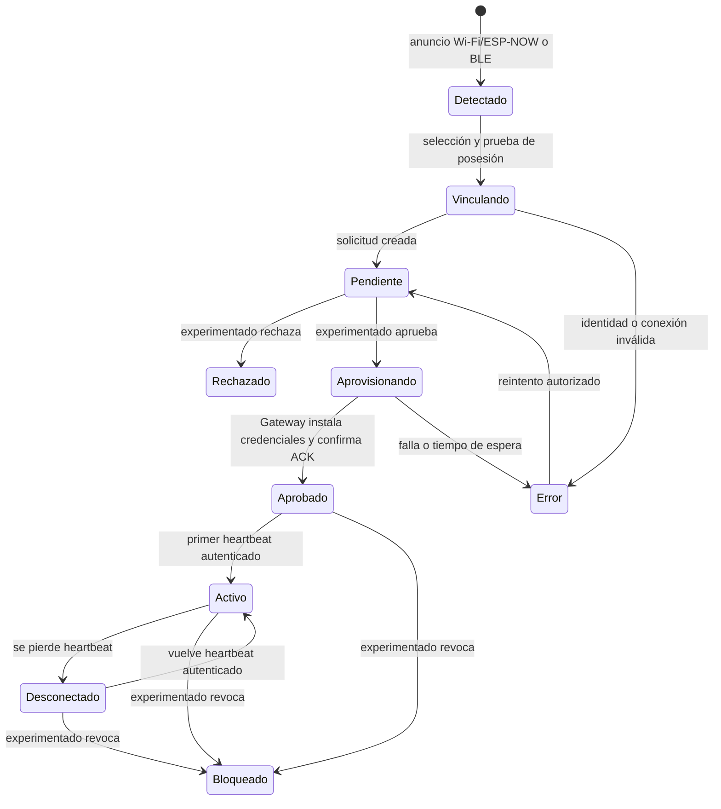
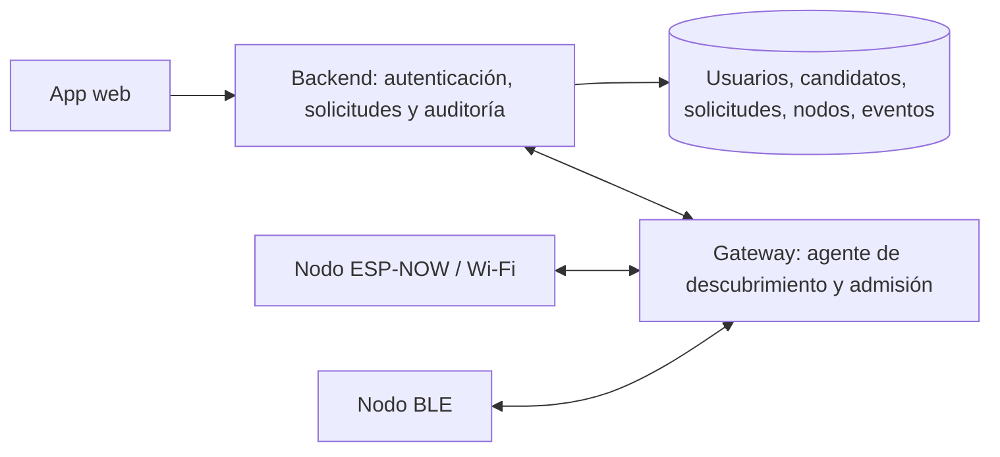

# Especificación: registro y aprovisionamiento de dispositivos IoT

> **Implementación para kits nuevos:** el flujo aplicado al repositorio se documenta en [KITS_ESP32.md](KITS_ESP32.md). Cada kit se fabrica con un Gateway y tres peers ESP-NOW ya configurados; la aprobación abre el acceso en el backend y el primer latido autenticado confirma actividad. BLE ofrece descubrimiento de esos mismos nodos. Las secciones siguientes conservan el diseño de una futura allowlist dinámica y un transporte BLE operativo completo.

## Alcance y estado del proyecto

Esta especificación define la experiencia de registro de cuentas y el ciclo de incorporación de nodos ESP32 a un Gateway central. En el proyecto actual, los nodos se comunican con el Gateway por **ESP-NOW** (tramas Wi-Fi), el Gateway usa Wi-Fi para comunicarse con el backend y los peers, MAC y claves se configuran en firmware. El backend ya distingue `basico` y `avanzado`, y registra nodos en estado `pendiente`; sin embargo, hoy un `sync` válido los marca `activo`. La detección BLE, la lista dinámica de candidatos y la aprobación antes de activarlos son capacidades **por implementar**.

**Decisión de transporte:** Wi-Fi cubre el enlace ESP-NOW existente y puede ampliarse a nodos Wi-Fi/IP mediante un adaptador específico. BLE es un segundo transporte de descubrimiento y aprovisionamiento; un nodo BLE persistente requiere su propio adaptador de datos en el Gateway. La aplicación web solicita escaneos al Gateway y muestra sus resultados: no se le atribuye acceso directo a las radios del equipo del usuario.

## 1. Registro de cuenta y roles

**Formulario:** nombre completo, correo electrónico, contraseña, confirmación de contraseña y la pregunta obligatoria **«¿Tienes conocimientos técnicos avanzados sobre el proyecto?»** con opciones **Sí** y **No**. Se mantienen las validaciones actuales: nombre mínimo de 3 caracteres, correo con formato válido, contraseña de 12 caracteres o más con mayúscula, minúscula, número y símbolo, y coincidencia con su confirmación. El correo se normaliza a minúsculas; la contraseña se almacena como hash.

| Elección | Interacción antes del envío | Resultado |
| --- | --- | --- |
| No | Envío directo | Rol persistido `basico`; interfaz simplificada. |
| Sí | Al pulsar «Crear cuenta», se abre el modal de advertencia. «Volver» conserva el formulario sin crear la cuenta. | Solo «Acepto los Riesgos» permite enviar el registro y asignar el rol persistido `avanzado` (etiqueta visible **Experimentado**). |

**Texto exacto del modal:**

> Atención: El modo avanzado te otorga acceso directo a la configuración de nodos, rotaciones, administración de red y aprobación de dispositivos en el Gateway. Modificar estos parámetros sin el conocimiento adecuado puede causar fallas en el sistema. Ingresas bajo tu propio riesgo. ¿Deseas continuar?

El modal debe tener foco inicial en su encabezado, foco contenido mientras está abierto, soporte de teclado, botones distinguibles y devolución del foco a «Crear cuenta» al cerrarse. El clic fuera del modal o Escape equivale a «Volver». El botón de aceptación es explícito, sin casilla preseleccionada. El cliente envía `aceptaRiesgosAvanzados: true` únicamente tras la aceptación; el servidor lo exige cuando `tieneConocimientoTecnico` es `true` y registra `accepted_at` y versión del aviso. El frontend por sí solo no autoriza el rol.

**Límite de confianza:** esta selección es una declaración del propio usuario, no una prueba de competencia ni de confianza administrativa. Si el sistema se despliega para varios usuarios no confiables, la capacidad de aprobar dispositivos debe requerir además una habilitación controlada por un administrador. El contrato funcional solicitado mantiene «Experimentado» como único rol de usuario que puede aprobar o rechazar; esta habilitación adicional se recomienda antes de producción.

## 2. Flujos de usuario

### Modo simplificado

1. En «Mis dispositivos», el usuario pulsa **Buscar Dispositivos** y elige un Gateway al que tenga acceso, si hay más de uno.
2. La app solicita al backend una sesión de escaneo de tiempo limitado. El Gateway anuncia o escucha candidatos compatibles por ESP-NOW/Wi-Fi y BLE, según las capacidades habilitadas. La pantalla muestra progreso, medio detectado, nombre legible, señal aproximada y un identificador abreviado; ofrece reintento si no encuentra nada.
3. El usuario selecciona un candidato y pulsa **Vincular al Gateway**. El sistema realiza la prueba de posesión o autenticación inicial requerida por ese transporte y crea una solicitud ligada al usuario y al Gateway. No pide MAC, ID de nodo, puertos ni rotaciones.
4. La pantalla muestra **Solicitud enviada · Pendiente de aprobación**, identificador de solicitud y estado actualizado. La vinculación únicamente establece un canal de aprovisionamiento limitado: el nodo aún no recibe órdenes operativas ni aporta telemetría activa.
5. Tras la decisión, el usuario ve **Aprobado**, **Rechazado** o **Requiere acción**. Un rechazo informa un motivo apto para mostrar; no revela claves ni datos sensibles.

### Modo experimentado

En el menú superior «Zona Técnica > Solicitudes del Gateway», la persona experimentada ve solicitudes de todos los usuarios y candidatos reportados por cada Gateway, con Gateway, transporte, MAC/ID de radio, modelo, solicitante, hora, evidencia de identidad, estado y alertas de duplicidad. Puede filtrar, inspeccionar, **Aprobar** o **Rechazar**, añadiendo un motivo en el rechazo. Una confirmación muestra el Gateway y el ID definitivo antes de aprobar.

«Zona Técnica > Añadir dispositivo» ofrece dos métodos:

- **Automático:** el mismo escaneo Wi-Fi/ESP-NOW o BLE, con acceso a detalles técnicos y a la decisión de aprobación.
- **Manual avanzado:** MAC normalizada, Gateway, ID de nodo único, transporte y los parámetros pertinentes. «Puerto» se define en el formulario según el transporte: puerto de servicio de red para Wi-Fi/IP; BLE usa servicio/característica; ESP-NOW no usa puerto TCP/UDP. Un `COMx` solo es un puerto serie temporal de grabación y no forma parte de la identidad ni del inventario. La configuración de rotaciones usa una política o intervalo validado y puede heredar el valor por defecto. El registro manual crea una solicitud verificable; el experimentado puede aprobarla en la misma operación confirmada, pero nunca se activa por el mero hecho de introducir una MAC.

## 3. Ciclo de vida y reglas de autorización

`Detectado` es efímero y no representa pertenencia a la red. `Pendiente` es un estado de **admisión**. `Aprobado` indica que el Gateway instaló el acceso, mientras que `Activo` y `Desconectado` expresan conectividad después de la aprobación. La interfaz debe mantener separados el estado de admisión y el de conectividad; el diagrama combina ambos para describir el recorrido. En cada transición se registran actor, Gateway, fecha, resultado y motivo. Solo el backend, tras autorizar el rol y registrar la decisión, puede mandar al Gateway el cambio de allowlist. El ACK del Gateway convierte `Aprovisionando` en `Aprobado`; el primer heartbeat autenticado confirma `Activo`. Si falta el ACK, queda pendiente de reintento. Un heartbeat de un candidato no puede activar el registro.

Una MAC es un localizador, no una prueba suficiente de identidad. La solicitud debe incluir un secreto de fábrica, código de posesión o credencial equivalente verificable; se aplica antirrepetición con nonce y vencimiento. Las claves de operación se entregan por un canal de aprovisionamiento autenticado y nunca se exponen en las respuestas generales, eventos o UI. Reintentos y aprobaciones repetidas deben ser idempotentes. Una misma identidad física no puede quedar aprobada simultáneamente en dos Gateway sin una transferencia explícita.

## 4. Arquitectura del Gateway

**Gateway:** un adaptador por transporte detecta candidatos y entrega eventos a un registro temporal deduplicado por `gateway_id + identidad de radio + transporte`, con tiempo de expiración. Un agente de admisión separa una lista de candidatos, una lista de solicitudes pendientes y una **allowlist activa** persistida. Mientras el nodo está pendiente, solo se permite el intercambio mínimo para demostrar identidad y estado; se descartan telemetría y comandos operativos. Al aprobar, el Gateway valida versión de la orden, instala el peer y las claves de forma atómica, guarda la configuración en NVS y responde ACK. Al rechazar o bloquear, elimina o invalida el peer y la clave, y registra el resultado. Al reiniciar, reconstruye la allowlist aprobada y reconcilia versiones con el backend.

**Backend:** autoridad para identidad, rol, pertenencia al Gateway y decisiones. Mantiene solicitudes y auditoría transaccionales y envía comandos autenticados al Gateway. El contrato actual `POST /api/gateway/sync` firma por nodo y actualiza `pendiente` a `activo`; debe impedirse esa transición antes de incorporar el nuevo flujo. El canal de control del Gateway debe autenticar al propio Gateway y vincular cada orden a su `gateway_id`, evitando usar una identidad de nodo como identidad administrativa del Gateway.

**Persistencia propuesta:** `gateways(id, estado, version_allowlist)`, `candidatos(id, gateway_id, transporte, identidad_radio, visto_en, expira_en, evidencia)`, `solicitudes_dispositivo(id, gateway_id, candidato_id, solicitante_id, metodo, estado, creado_en, decidido_por, decidido_en, motivo)`, `nodos(..., gateway_id, admission_status, connection_status, transport, port_or_service, rotation_policy, credential_ref)` y `eventos` de auditoría. Índices únicos para ID de nodo y para identidad física normalizada dentro del dominio definido. Los secretos deben ir en almacenamiento protegido o cifrado, con referencias en la tabla pública.

**API propuesta:**

| Operación | Actor | Efecto |
| --- | --- | --- |
| `POST /api/gateways/:id/scans` | Autenticado con acceso a ese Gateway | Inicia escaneo acotado; devuelve `scanId`. |
| `GET /api/gateways/:id/scans/:scanId/candidates` | Solicitante o experimentado | Lista candidatos sanitizados. |
| `POST /api/gateways/:id/device-requests` | Usuario autenticado | Vincula candidato o crea solicitud manual según permisos. |
| `GET /api/gateways/:id/device-requests` | Experimentado | Lista solicitudes y evidencia técnica. |
| `POST /api/device-requests/:id/approve` | Experimentado | Decisión idempotente y orden de aprovisionamiento. |
| `POST /api/device-requests/:id/reject` | Experimentado | Rechazo auditado y descarte de acceso provisional. |
| `GET /api/device-requests/:id` | Solicitante o experimentado | Estado para seguimiento o actualización en tiempo real. |

El firmware actual usa una tabla fija de peers y no implementa BLE. La coexistencia de BLE con Wi-Fi/ESP-NOW depende del chip y la carga de radio. Antes de prometer escaneo BLE continuo en el mismo ESP32 Gateway, se necesita una prueba de recepción ESP-NOW y latencia de heartbeat durante el escaneo; si se degrada, usar ventanas de escaneo o un coprocesador BLE. La documentación oficial de Espressif recomienda evaluar seguridad y prueba de posesión durante el aprovisionamiento: <https://docs.espressif.com/projects/esp-idf/en/stable/esp32/api-reference/provisioning/provisioning.html>. La coexistencia está documentada en <https://docs.espressif.com/projects/esp-idf/en/stable/esp32/api-guides/coexist.html>.

## 5. Criterios de aceptación por historia

### Frontend

- **FE-1 Registro:** dado un formulario válido con «No», al enviarlo se crea una cuenta básica sin modal. Con «Sí», se presenta el texto exacto y no se envía nada hasta pulsar «Acepto los Riesgos»; «Volver» conserva los datos.
- **FE-2 Búsqueda simplificada:** un usuario básico puede iniciar búsqueda y ver progreso, candidatos Wi-Fi/ESP-NOW o BLE y errores recuperables; al seleccionar uno ve «Solicitud enviada · Pendiente de aprobación» sin campos de MAC, puerto o rotación.
- **FE-3 Decisión técnica:** un experimentado ve solicitudes por Gateway, sus datos y estados; puede aprobar o rechazar con confirmación, y los controles no aparecen para el rol básico. La UI muestra los estados de admisión y conectividad por separado.
- **FE-4 Registro manual:** el formulario avanzado valida MAC, ID, Gateway, transporte y configuración aplicable; no pide puerto de red para ESP-NOW/BLE ni guarda COM como identidad.

### Backend

- **BE-1 Rol y consentimiento:** si `tieneConocimientoTecnico=true` sin aceptación explícita, `POST /api/auth/register` devuelve 400 y no crea usuario; con aceptación registra el consentimiento versionado y `avanzado`; con `false` asigna `basico`.
- **BE-2 Autorización:** solo `avanzado` puede aprobar, rechazar y registrar manualmente; una llamada básica a esos endpoints devuelve 403. La autorización se comprueba en servidor y vuelve a consultar el rol vigente, no solo un JWT antiguo.
- **BE-3 Identidad y solicitudes:** el backend valida formato de MAC, ID y prueba de posesión, rechaza duplicados y crea una sola solicitud por candidato/Gateway ante reintentos; registra solicitante, fecha y método.
- **BE-4 Transición segura:** `sync` de un nodo no aprobado no modifica su admisión ni lo muestra activo. Una aprobación crea orden versionada; solo el ACK del Gateway confirma la activación. Rechazos y bloqueos invalidan permisos operativos y quedan auditados.
- **BE-5 Aislamiento:** un usuario básico solo consulta sus solicitudes y los Gateway a los que pertenece; un experimentado ve las solicitudes de su ámbito. No se retornan claves en listados ni eventos.

### Firmware y Gateway

- **GW-1 Descubrimiento:** en una ventana de escaneo solicitada, el Gateway reporta candidatos por ESP-NOW/Wi-Fi y BLE habilitado, deduplica anuncios y caduca entradas sin afectar peers activos.
- **GW-2 Cuarentena:** un candidato no aprobado puede efectuar solo el intercambio de incorporación; el Gateway descarta telemetría y comandos operativos, incluso después de reiniciar.
- **GW-3 Aprovisionamiento:** con orden autenticada, válida y versionada, instala el peer/credenciales en memoria persistente y responde ACK; la repetición de la orden no duplica peers. Ante error, mantiene la allowlist anterior y comunica la falla.
- **GW-4 Revocación:** rechazo o bloqueo impide nuevos mensajes operativos y elimina credenciales provisionales; una pérdida del backend no convierte pendientes en activos.
- **GW-5 Coexistencia:** con tres nodos actuales transmitiendo heartbeats, activar el escaneo BLE durante el tiempo definido no sobrepasa los umbrales de pérdida y latencia que se fijen en la campaña de rendimiento; si los supera, se limita la ventana de escaneo o se usa hardware BLE separado.

## 6. Secuencia de implementación sugerida

1. Corregir registro y consentimiento de rol; definir control de confianza para aprobadores.
2. Separar admisión de conectividad en datos, API y UI; cerrar la activación por `sync`.
3. Implementar solicitudes, autorización, auditoría y canal de control autenticado del Gateway.
4. Reemplazar peers fijos por allowlist dinámica persistente y agregar descubrimiento Wi-Fi/ESP-NOW.
5. Añadir BLE y validar coexistencia con los tres nodos físicos antes de habilitar escaneo continuo.
